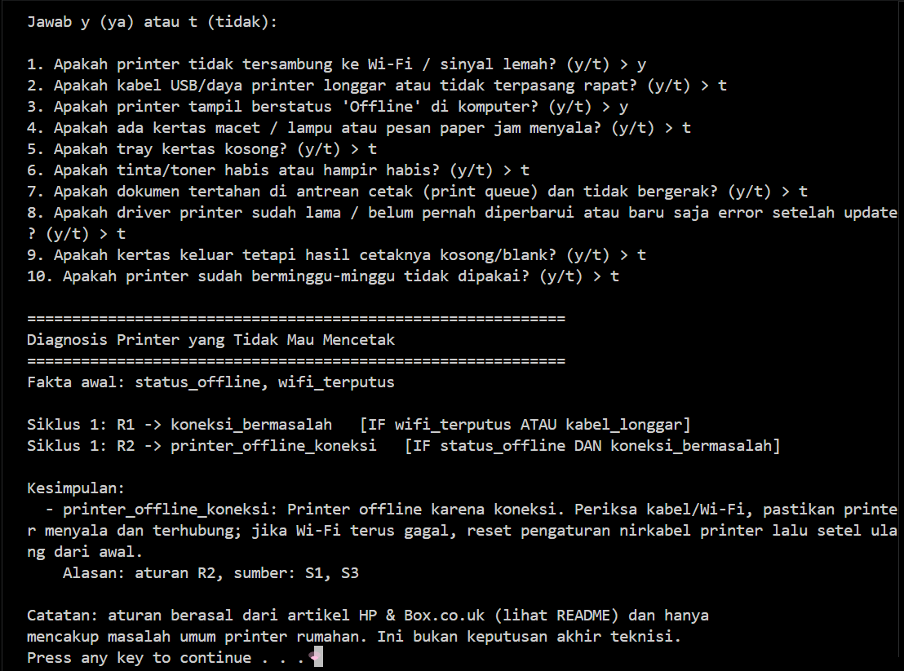
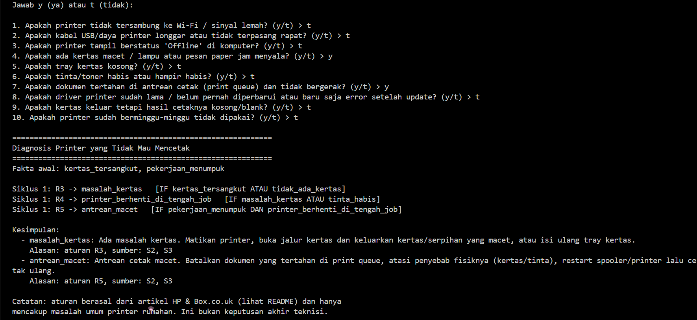
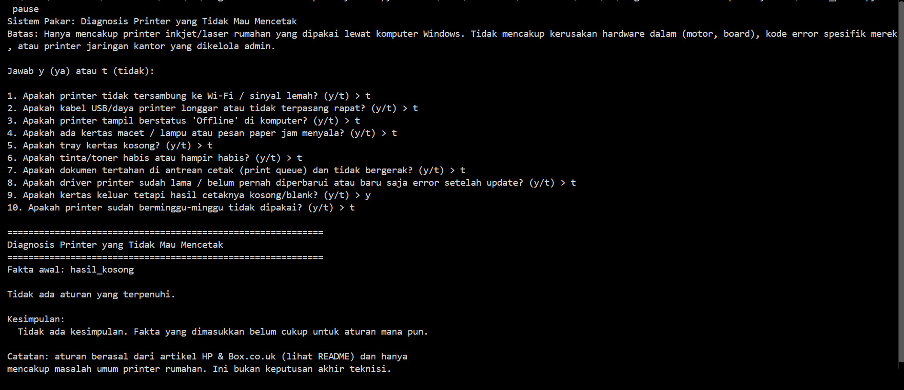

# Sistem Pakar Diagnosis Printer Tidak Mau Mencetak

**Nama:** Baiq Febylia Eka Ningrum  
**NIM:** F1D02410109

## 1. Topik dan Program
- **Topik:** diagnosis penyebab printer rumahan tidak mau mencetak (koneksi, kertas, antrean cetak, driver, tinta).
- **Bahasa:** Python 3 (tanpa library tambahan)
- **Menjalankan:**
  ```
  python sistem_pakar.py                       # mode tanya-jawab
  python sistem_pakar.py --jawab wifi_terputus,status_offline   # mode otomatis
  ```
- **File:** `sistem_pakar.py` (program), `kb_printer.json` (basis pengetahuan)

## 2. Daftar Sumber
| Kode | Judul | Penerbit/Penulis | Tanggal terbit | URL | Diakses |
|---|---|---|---|---|---|
| S1 | Printer Troubleshooting: Quick Fixes for Common Printing Problems | HP / Oluwakemi Oladapo | 23 Feb 2026 | https://www.hp.com/us-en/tech-takes/printers/troubleshooting/printer-troubleshooting-common-problems-quick-fixes.html | 11 Nov 2026 |
| S2 | Print job stuck in queue | HP Support | (tidak tercantum) | https://support.hp.com/us-en/help/printer/print-job-stuck | 11 Nov 2026 |
| S3 | Printer Not Working? Common Printing Problems and Easy Fixes | Box.co.uk | 8 Jul 2026 (terakhir diperbarui) | https://box.co.uk/blog/printer-not-working-common-problems-fixes | 11 Nov 2026 |

## 3. Aturan IF-THEN
| Aturan | IF | THEN | Sumber |
|---|---|---|---|
| R1 | wifi_terputus ATAU kabel_longgar | koneksi_bermasalah | S1, S3 |
| R2 | status_offline DAN koneksi_bermasalah | printer_offline_koneksi | S1, S3 |
| R3 | kertas_tersangkut ATAU tidak_ada_kertas | masalah_kertas | S2, S3 |
| R4 | masalah_kertas ATAU tinta_habis | printer_berhenti_di_tengah_job | S2 |
| R5 | pekerjaan_menumpuk DAN printer_berhenti_di_tengah_job | antrean_macet | S2, S3 |
| R6 | status_offline DAN driver_lama | driver_bermasalah | S1 |
| R7 | hasil_kosong DAN lama_tidak_dipakai | kepala_cetak_kering | S1 |
| R8 | hasil_kosong DAN tinta_habis | kartrid_perlu_diganti | S3 |

## 4. Metode: Forward Chaining (FC)
Program menyimpan fakta dari jawaban user di memori kerja. Lalu aturan diperiksa satu per satu: jika kondisi IF terpenuhi (DAN = semua, ATAU = salah satu) dan hasil THEN belum ada di memori, hasilnya ditambahkan sebagai fakta baru. Pemeriksaan diulang sampai tidak ada fakta baru. Hasil sebuah aturan bisa menjadi syarat aturan lain (contoh: R3 -> R4 -> R5), sehingga terbentuk rantai penalaran.

## 5. Kasus Uji
| # | Jawaban "ya" | Kesimpulan |
|---|---|---|
| 1 | wifi_terputus, status_offline | printer_offline_koneksi (R1 -> R2) |
| 2 | kertas_tersangkut, pekerjaan_menumpuk | antrean_macet (R3 -> R4 -> R5) |
| 3 | hasil_kosong saja | **tidak ada kesimpulan** (kasus negatif) |

Screenshot:





## 6. Batas Keberlakuan
Aturan hanya berlaku untuk masalah umum printer inkjet/laser rumahan yang dipakai lewat komputer Windows. Sistem tidak mendiagnosis kerusakan hardware dalam, kode error khusus merek, atau printer jaringan kantor. Hasilnya adalah pengetahuan awal dari artikel, bukan keputusan akhir; jika masalah berlanjut, hubungi teknisi atau dukungan produsen.

## 7. Penggunaan AI
(Tulis jujur.) Contoh: "AI (Claude) dipakai untuk membantu menyusun kerangka program dan basis aturan; saya memeriksa sumber dan menjalankan program sendiri."